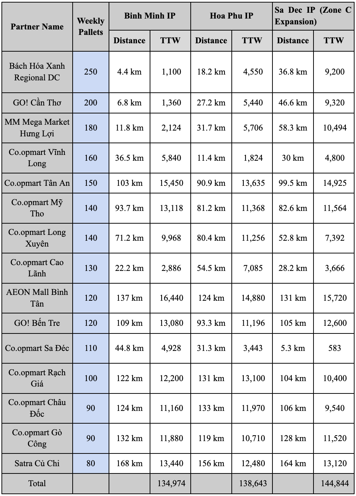

# 02. Total Transportation Workload (TTW) Analysis

## 1. Project Background

Mekong KVD evaluated three candidate industrial parks as potential locations for its centralized Mega Hub.

To compare transportation efficiency, the project calculated the Total Transportation Workload (TTW) from each candidate location to 15 B2B partners.

## 2. Analysis Objective

The objective was to compare the transportation workload of the three candidate industrial parks based on weekly delivery volume and road distance.

## 3. TTW Calculation Method

The project applied the following formula:

**TTW = Σ (Qi × Di)**

Where:

- Qi = Weekly delivery volume for each partner (pallets).
- Di = Road distance from the candidate industrial park to each partner (km).

**Unit:** Pallet-km per week.

## 4. Analysis Results

| Candidate Industrial Park | Total TTW (Pallet-km) |
|---|---:|
| Binh Minh IP | 134,974 |
| Hoa Phu IP | 138,643 |
| Sa Dec IP (Zone C Expansion) | 144,844 |

## 5. Key Findings

**Binh Minh Industrial Park**

- Achieved the lowest TTW at 134,974 pallet-km.
- Serves the largest customer group among its nearest delivery points, representing 760 pallets per week.
- Provides a favorable transportation workload for the overall distribution network.

**Hoa Phu Industrial Park**

- Recorded 138,643 pallet-km.
- Its TTW was approximately 2.72% higher than Binh Minh IP.

**Sa Dec Industrial Park**

- Recorded the highest TTW at 144,844 pallet-km.
- Was less suitable as the central distribution location based on this transportation workload comparison.

## 6. Conclusion

Binh Minh Industrial Park achieved the lowest Total Transportation Workload among the three candidates.

This result supported the selection of Binh Minh Industrial Park as the proposed Mega Hub location from a transportation workload perspective.

## 7. My Contribution

My contribution included participating in the Total Transportation Workload analysis, reviewing transportation data, and supporting the comparison of candidate industrial park locations.

## 8. Project Evidence

Supporting calculation tables, transportation data, and analysis results will be added to this folder.

**Course:** SCLM 429 – Transportation and Logistics Management  
**Project:** Mekong KVD – Group Brainy

---

## 9. Project Evidence

### Evidence 01: Total Transportation Workload Calculation

This table presents the transportation workload analysis for 15 B2B partners across three candidate industrial parks.

It includes weekly delivery volumes, transportation distances, and the calculated Total Transportation Workload (TTW).

The results are used to compare transportation workload and support the Mega Hub location selection.

