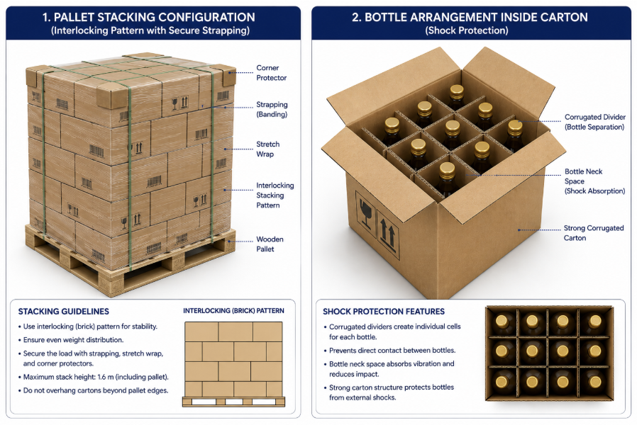
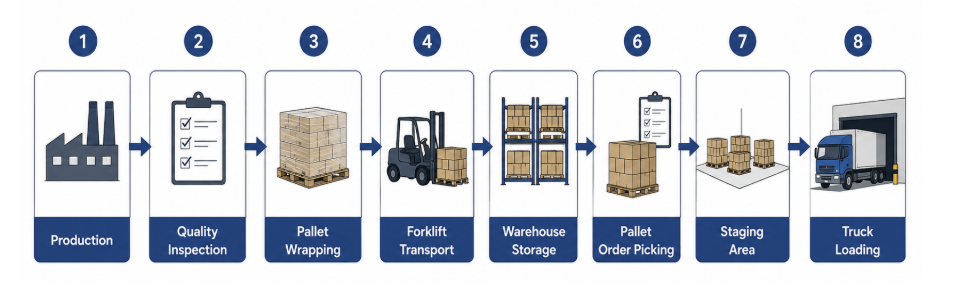
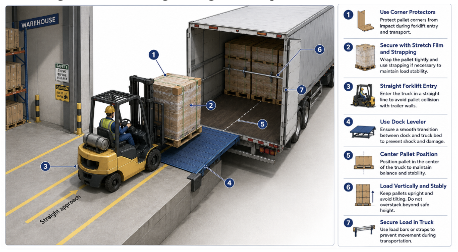

# 04. Material Handling Strategy

## 1. Project Background

Mekong KVD distributes fish sauce, soy sauce, and cooking oil in glass bottles. These products are fragile and require proper packaging, handling, and transportation to prevent damage.

The project proposed a standardized material handling strategy to improve product protection and warehouse efficiency throughout the distribution process.

## 2. Protective Packaging and Pallet Configuration

The proposed packaging solution includes:

- Corrugated cartons with internal dividers to separate individual glass bottles.
- Shock-absorbing space around bottle necks.
- Interlocking (brick) stacking patterns to improve pallet stability.
- Rigid corner protectors, strapping bands, and stretch wrapping.
- Maximum pallet height of 1.6 meters.

These measures help prevent bottle-to-bottle contact, reduce vibration damage, and maintain load stability during transportation.

## 3. Safe Warehouse Handling

The project proposed a standardized warehouse flow:

1. Production
2. Quality Control Inspection
3. Pallet Wrapping
4. Forklift Transportation
5. Warehouse Storage
6. Order Picking
7. Staging
8. Truck Loading

The project applied the **Single-Pallet Journey** principle, meaning finished products remain on their original pallet from production until truck loading.

This reduces unnecessary repalletizing, repeated manual handling, and the risk of glass bottle breakage.

## 4. Safe Loading and Transit Damage Prevention

The proposed loading practices include:

- Following standardized loading procedures.
- Maintaining pallet stability.
- Securing loads inside trucks.
- Reducing vibration and impact during transportation.

These practices help protect fragile products throughout the delivery process.

## 5. Key Benefits

- Reduced product damage and glass bottle breakage.
- Improved warehouse handling efficiency.
- Less unnecessary pallet movement.
- Better load stability during transportation.
- More consistent material handling operations.

## 6. My Contribution

My contribution focused on the Material Handling part of the group project.

I participated in developing and presenting the proposed packaging, pallet configuration, warehouse handling, and product protection solutions.

This work helped me understand how packaging design and warehouse operations affect product safety and logistics efficiency.

## 7. Project Evidence

Supporting materials include:

- Protective packaging and pallet stacking configuration.
- End-to-end warehouse handling process.
- Safe loading and transit damage prevention practices.

**Course:** SCLM 429 – Transportation and Logistics Management  
**Project:** Mekong KVD – Group Brainy

---

## 8. Project Evidence

### Evidence 01: Protective Packaging and Pallet Configuration

### Evidence 02: End-to-End Warehouse Handling Process

### Evidence 03: Safe Loading and Transit Damage Prevention

